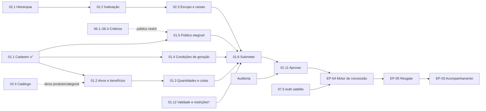

# 🗺️ Roadmap do Backend — VoucherCampaigns

> Data: 2026-10-20
> Autor: Iago V. R.
> Base: backlog oficial em `D:\residenciaIV\docs` (EP-01 a EP-07) e estado atual do repositório (`docs/PROJECT_STATE.md`)

Objetivo: chegar o quanto antes a uma **base útil** (campanha configurada, aprovada e concedendo voucher a uma aplicação satélite) e organizar o trabalho em **trilhas paralelas**, de modo que cada integrante, apoiado por IA (Claude, Codex, Cursor), consiga entregar um épico ou uma fatia grande dele sem depender dos outros a cada passo.

---

## 1. Estado atual

| Item | Situação | Entrega |
|---|---|---|
| GH-010 Setup do projeto | ✅ Mesclado | Solution .NET 10 em camadas, SQLite/PostgreSQL por configuração, testes |
| GH-008 Banco de dados | ✅ Mesclado | Hierarquia, catálogo e campanhas; `CHECK`s; seed de demonstração |
| US-02.5 Escopo de atuação | 🔄 PR aberto | Login provisório, papéis `analista`/`gestor`, TenantGuard, erros `ProblemDetails` com `code` |
| US-01.1 Cadastrar campanha | 🔄 PR aberto (sobre a US-02.5) | `POST /api/v1/campaigns` em rascunho, RN02 no fuso da rede, `Network.TimeZone` |

---

## 2. Dependências entre US

### 2.1 Cadeia principal

\* A US-01.12 ainda não existe no backlog (ver seção 2.3).

### 2.2 Peças transversais (construir uma vez, cedo)

| Peça | Quem depende | Observação |
|---|---|---|
| **Trilha de auditoria** (eventos imutáveis) | 01.11, 03.4, 04.7, 05.4 | Feita isoladamente em cada US, viraria 4 implementações diferentes |
| **US-07.5** Autenticar aplicações satélites | Toda a EP-07 e o acesso ao motor via API | Independente; pode começar já |
| **Status efetivo** (agendada → ativa → encerrada pelas datas, PR-04) | 01.9, 01.11, EP-04 | Proposta: calcular o status na leitura, sem job agendado |
| **Projeção local de usuários** | 01.6 e 01.11 (quem submeteu e quem aprovou) | Depende do cliente; até lá, gravar o `UserId` do token |

### 2.3 Lacuna no backlog (bloqueia EP-04 e EP-05)

Nenhuma US configura:

- a **regra de validade do voucher** (prazo relativo ou data fixa, com teto, RF18a), usada pela 04.3 e pela 05.3;
- as **restrições de uso** (valor mínimo e máximo da compra, limite de utilizações por voucher), usadas pela 05.2 e pela 05.4.

**Proposta ao PO:** criar a **US-01.12 "Configurar validade e restrições de uso do voucher"** no EP-01.

### 2.4 Decisões em aberto com o cliente

| # | Decisão | Bloqueia |
|---|---|---|
| D1 | Critério de desempate quando mais de uma campanha é satisfeita | 04.1 (cenário 5) |
| D2 | Contador de compras do cliente: enviado pelo satélite ou persistido pela plataforma | Condição "quantidade de compras" (01.4 / 04.1) |
| D3 | Modelo de concessão provisória (P12) | 04.9, 07.2 |
| D4 | Atributos do cliente enviados pelo satélite (só CPF?) | 04.2 e critérios de perfil da EP-06 |
| D5 | Origem das contas de analista e gestor (importação, projeção local ou SSO) | Projeção local de usuários (02.5) |
| D6 | Edição de campanha agendada; motivo obrigatório na reprovação | 01.7, 01.11 |
| D7 | Campanha com loja única inativada | 02.2 |
| D8 | Formato da exportação | 03.5 |
| D9 | Fim da vigência às 23:59 inclui o minuto inteiro? | Vigência (01.1 / 04.4) |

---

## 3. Plano em ondas

### Onda 0 — Destravar o paralelismo (1 a 2 pessoas)

1. Mesclar os PRs da US-02.5 e da US-01.1.
2. **Spec de contratos compartilhados:** esquema de `Voucher`, `VoucherEvent`, `AuditEntry`, `CampaignCondition` e `EligibilityCriterion` (entidades, enums e migração). Assim, cada trilha implementa sobre o mesmo modelo.
3. **Reduzir conflitos entre branches paralelas:**
   - cada módulo registra seus serviços em um método próprio (`AddCampaignsModule()`, `AddVouchersModule()`...), para que `Program.cs` e `DependencyInjection.cs` não entrem em conflito a cada PR;
   - migrações: uma por PR; quem rebasear depois de outra migração entrar regenera a sua com `sh scripts/add-migration.sh`.
4. Levar a lista de decisões (2.4) e a proposta da US-01.12 ao cliente e ao PO.

### Onda 1 — Configuração completa (4 trilhas em paralelo)

| Trilha | Responsável | Sequência |
|---|---|---|
| **A — Configuração da campanha (EP-01)** | Pessoa 1 | 01.9 consulta → 01.2 alvos → 01.3 quantidades → 01.4 condições → 01.5 público ("todos") → 01.12 validade e restrições → 01.7 (edição em rascunho) |
| **B — Cadastros de apoio (EP-02)** | Pessoa 2 | 02.4 catálogo → 02.1 hierarquia → 02.2 inativação → 02.3 escopo e canais → 02.6 herança de fuso e moeda |
| **C — Governança e integrações** | Pessoa 3 | Auditoria → status efetivo → 07.5 auth satélite e padrão de erros da EP-07 |
| **D — Elegibilidade (EP-06, configuração)** | Pessoa 4 | 06.1 perfil → 06.2 histórico → 06.3 combinação → 06.4 grupos e clientes específicos |

**Pontos de contato:**

- A trilha A usa alvo `TODOS` até a trilha B entregar a 02.4. Depois habilita alvos de categoria e produto.
- A 01.5 com público restrito se liga aos critérios da trilha D quando estiverem prontos.

### Onda 2 — Ciclo de vida e motor (🎯 Marco 1: base útil)

| Trilha | Sequência |
|---|---|
| **A** | 01.10 duplicar → 01.8 pausar e encerrar (efeito sobre vouchers vem na onda 3) |
| **C** | 01.6 submeter (RN01) → 01.11 aprovar (alçada e auditoria) |
| **E — Motor (EP-04 + 07.2 / 07.4)** | Quem terminar a trilha B ou D: 04.3 emissão e validade → 04.4 bloqueio por status → 04.1 condições (valor total e categoria primeiro) → 04.5 saldo e concorrência → 04.6 idempotência → 04.9 provisório → 04.7 histórico → 04.8 + 07.2 / 07.4 como fachada HTTP |
| **D** | 06.5 elegibilidade na emissão (junto da 04.2, com a trilha E) → 06.6 simulação |

> **Marco 1:** o analista configura e submete, o gestor aprova, a campanha fica ativa e uma aplicação satélite autenticada recebe o voucher por API.

### Onda 3 — Resgate (🎯 Marco 2: ciclo completo)

| Trilha | Sequência |
|---|---|
| **F — Resgate (EP-05 + 07.3)** | 05.1 verificação → 05.2 restrições → 05.3 validade → 05.4 utilizações e concorrência → 05.6 alvo mais específico → 05.5 efeito do status da campanha |
| **A** | 01.8 cancelar (invalida vouchers, junto da 05.5) → 01.9 com "esgotada" e emitidos → 01.7 edição após entrar em vigor (RN03b, RN02a) |
| **C** | 07.1 campanhas vigentes por API |

> **Marco 2:** voucher emitido e resgatado nos canais, com histórico completo.

### Onda 4 — Acompanhamento (EP-03)

03.1 indicadores → 03.3 portfólio → 03.2 filtros → 03.4 tela de auditoria (dados existem desde a onda 1) → 03.5 exportação.

---

## 4. Lista consolidada por prioridade

| Prioridade | US |
|---|---|
| **P0 — Fundações** | Mesclar 02.5 e 01.1 · contratos compartilhados · auditoria · status efetivo · 07.5 |
| **P1 — Configuração** | 01.9, 01.2, 01.3, 01.4, 01.5, 01.12\*, 02.4, 02.1, 02.2, 02.3, 06.1, 06.2, 06.3, 06.4 |
| **P2 — Base útil** | 01.6, 01.11, 04.1 a 04.9, 06.5, 07.2, 07.4, 01.10, 01.8 (pausar e encerrar) |
| **P3 — Resgate** | 05.1 a 05.6, 07.3, 07.1, 01.7 (após vigor), 01.8 (cancelar) |
| **P4 — Gestão** | 03.1 a 03.5, 02.6 completa, 06.6 |

\* US a ser criada no backlog.

---

## 5. Fluxo de desenvolvimento por US (com IA)

Ciclo SDD já usado nas US-02.5 e US-01.1 (`docs/prompts/` e `agents.md`):

1. **Branch:** `feat/US-XX.Y-nome` a partir da `main`. Empilhar sobre outra branch só quando depender de um PR ainda aberto (a base do PR passa a ser essa branch).
2. **Spec (`resume-session`):** a IA lê a US no backlog e escreve a spec em `docs/specs/in-progress/US-XX.Y-nome.md`, a partir do template. A spec deve listar as **decisões e as divergências** encontradas no backlog: é o que mais evita retrabalho.
3. **Aprovação da spec:** o responsável pela trilha aprova as decisões. Nenhum código de produção antes disso.
4. **Implementação (`implement-spec`):** contratos → domínio → infraestrutura → endpoint → testes, seguindo as skills do `agents.md`:
   - `BusinessRuleException` → `422`;
   - "agora" sempre via `TimeProvider`;
   - `[ValidateTenantScope]` em rotas de rede;
   - migrações pelo script, nos dois conjuntos.
5. **Validação:** `dotnet test` verde e sem warnings, mais teste manual (Postman e PostgreSQL via `docker compose`).
6. **Fechamento (`save-session`):** spec em `docs/specs/completed/` com `Status: Completed`, `docs/PROJECT_STATE.md` atualizado e commit semântico.
7. **PR:** template com a seção de governança de IA; revisão pelo squad-3 (@squad-3-aiops).

**Por que uma pessoa por épico é viável:** `agents.md`, as specs concluídas e o `PROJECT_STATE.md` funcionam como memória compartilhada. Qualquer assistente começa a sessão conhecendo os padrões do projeto. O gargalo deixa de ser escrever código e passa a ser tomar decisões de negócio, por isso a onda 0 leva as decisões ao cliente logo de início.

---

## 6. Próximos passos imediatos

- [ ] Revisar e mesclar os PRs da US-02.5 e da US-01.1
- [ ] Definir os responsáveis pelas trilhas A, B, C e D
- [ ] Escrever e aprovar a spec de contratos compartilhados (onda 0)
- [ ] Levar ao cliente as decisões D1 a D9 e ao PO a proposta da US-01.12
- [ ] Iniciar a onda 1
